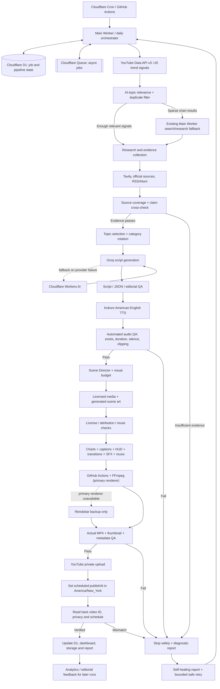
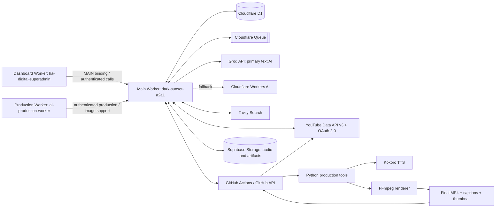
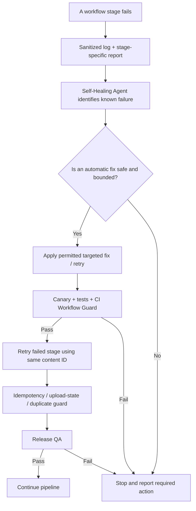

# AI Assistant Factory / AI Tech Lab — Complete Project Architecture
**Document date:** 13 October 2026  
**Repository:** `hamarketers05/ai-assistant-renderer` (branch `main`)  
**Purpose:** Single source of truth for the intended architecture, component responsibilities, API/Worker route inventory, current verified status, and remaining blockers.

> **Status discipline:** “Implemented in code” does not mean “live end-to-end verified.” Static fixtures do not prove a real video was rendered. A successful self-healing run does not prove the publishing pipeline passed. Never publish unless the actual audio/video/metadata have passed production QA.

---

## 1. Executive summary

AI Tech Lab is intended to automatically produce **one English, approximately six-minute YouTube video plus one Short per day** for a USA audience. The system should research current AI topics, select a relevant and evidence-backed topic, write an original script, generate natural American-English Kokoro narration, assemble original/appropriately licensed visuals and motion graphics, render through GitHub Actions + FFmpeg, run final quality checks, upload privately, and schedule publication in the configured US Eastern timezone.

**Primary architecture decisions**
- Main orchestrator/API: Cloudflare Worker `dark-sunset-a2a1`.
- Production/visual support Worker: `ai-production-worker`.
- Admin dashboard Worker: `ha-digital-superadmin`.
- Data/state: Cloudflare D1 and Queues; Supabase audio/object storage.
- Research and scripting: YouTube Data API v3 trend signals + Tavily/reputable RSS/Atom sources; Groq primary; Cloudflare Workers AI fallback.
- Voice: automatic Kokoro English voice generation. The current product direction is **no manual voice-approval requirement**; the generated voice must instead pass automated validation before rendering.
- Rendering: GitHub Actions + FFmpeg is primary; Rendobar is backup only.
- Publishing: YouTube Data API/OAuth, upload private, schedule publication rather than immediate public upload.
- Recovery: self-healing agent, watchdog, canary/rescue utilities, workflow guard, validation and regression tests.
- Cost policy: free-first; no paid API/service or billing requirement may be added without explicit approval.
- Preserve existing Workers, database, bindings, GitHub workflows, Supabase and OAuth architecture; use targeted fixes only.

## 2. End-to-end pipeline — intended production order

1. **Schedule / orchestration**
   - Cloudflare cron/supervisor and/or the existing GitHub Actions daily workflow starts a run.
   - Resolve date, US audience, content category rotation, duplicate-topic checks and content ID.
   - Persist run state so retries resume rather than create duplicate uploads.

2. **Trend discovery**
   - Read current US YouTube Data API v3 trend/chart signals using the existing OAuth/access-token flow.
   - Filter for explicitly AI-relevant topics; generic phones, televisions and unrelated tech must not enter AI Tech Lab topic selection.
   - Keep API quota low; use the existing Main Worker research/search route as a fallback rather than adding repeated chart requests.

3. **Research and source verification**
   - Search with Tavily when configured and free RSS/Atom sources as fallback; use official/primary sources plus independent reporting where available.
   - Cross-check important claims and preserve URLs, publication dates and source metadata.
   - If evidence or relevant AI trend signals are insufficient, fail closed and report the gap. Do not fabricate topics, sources or metrics.

4. **Topic choice / editorial angle**
   - Select one timely topic matching AI news, AI tools, AI agents, models, automation or future technology.
   - Check category rotation, topic similarity, novelty, USA relevance and source strength.
   - Keep facts separate from predictions/opinions. Persona/hot-take content may add original analysis but must not be presented as verified fact.

5. **Script generation**
   - Groq is the preferred text model/provider through the existing AI text client/Main Worker; Workers AI is fallback.
   - Produce an English script with a strong but accurate hook, clear explanation, evidence-based claims, practical viewer value, transitions and a concise conclusion.
   - Run script/JSON validation, claim checks, editorial review and voice-naturalness checks before voice generation.

6. **Automatic voice**
   - Generate American-English narration using Kokoro.
   - Run audio existence, duration, silence/pause, clipping, sample-rate and intelligibility checks; repair/edit only within safe bounds.
   - No manual approval gate is intended. If voice generation or validation fails, stop before rendering/upload and allow safe retry/recovery.

7. **Visual planning and asset acquisition**
   - Scene Director assigns visual intent and timing per narration segment.
   - Fetch assets only from configured, license-appropriate sources. Vecteezy is the required stock source where available, and only verified Free License assets with required attribution may be used. Do not add Pixabay or Pexels.
   - Track attribution/source/license and prevent accidental reuse. Do not claim 80–90 unique scenes unless the actual rendered project manifest confirms them.
   - If no compliant asset is available, use generated graphics or a clear fallback; never fake a source or license.

8. **Graphics, captions, sound and editing**
   - Generate evidence charts only from sourced data; do not invent chart numbers.
   - Add branded lower thirds, HUD overlays, motion, transitions, captions, restrained SFX and royalty-free/procedural music.
   - Synchronize scene changes to narration; avoid static-image sequences and excessive pauses.
   - Apply voice enhancement/mastering, music ducking and color grading where the actual workflow supports them.
   - Optional stereoscopic/SBS/3D conversion must never damage or replace the primary standard video; it is an optional export, not a prerequisite to normal publication.

9. **Render**
   - GitHub Actions + FFmpeg is the primary renderer.
   - The workflow consumes the content ID/script/metadata and validated audio/asset manifests, renders the video, and writes logs and output artifacts.
   - Rendobar may be used only as the backup path if the primary renderer fails and the fallback is explicitly configured.

10. **Final QA / release gate**
    - Validate video exists, is decodable, has expected duration/resolution/frame rate, includes audio, has no silent/truncated output, has captions, valid scene/asset manifests, attribution, thumbnail and metadata.
    - Check duplicate content, title/description/tags/category and safe source usage.
    - A passing static fixture is not enough; QA must inspect the actual output for that content ID.
    - On any critical failure, do not upload. Record the exact stage and artifact.

11. **YouTube upload and scheduling**
    - Obtain an OAuth access token from the existing Worker token route.
    - Upload as private first and set the intended scheduled publication time in `America/New_York`; do not directly publish publicly.
    - Verify the returned video ID, privacy status, scheduled publish time and subsequent platform state.
    - Prevent duplicate uploads on retry by using stored content/video IDs and upload-state checks.

12. **Persistence, reporting and learning**
    - Store content/job/research/QA/voice/publishing states in existing D1 tables and use the existing queue for jobs.
    - Store audio/assets/reports in configured Supabase storage where intended.
    - Update dashboard status, retain sanitized logs/recovery artifacts, and use analytics/feedback to improve later topic selection and scripts.

---

## 3. Architecture map

```text
Cloudflare Cron / GitHub Actions
             |
             v
Main Worker: dark-sunset-a2a1
  |-- D1 state + Queue jobs
  |-- Groq primary / Workers AI fallback
  |-- YouTube OAuth + research + control APIs
  |-- Supabase / GitHub workflow integration
             |
             v
US YouTube trend signals --> AI relevance filter
             |                       |
             +--> Worker research fallback (only when needed)
                                      |
                                      v
                    Tavily + official/primary + RSS evidence
                                      |
                                      v
                      Topic choice + source/claim QA
                                      |
                                      v
                     English script + editorial QA
                                      |
                                      v
                       Kokoro narration + audio QA
                                      |
                                      v
                 Scene Director + licensed/generated assets
                                      |
                                      v
         Charts / captions / overlays / SFX / music / color
                                      |
                                      v
                  GitHub Actions + FFmpeg renderer
                                      |
                                      v
                    Actual-file video + metadata QA
                                      |
                           pass only / fail closed
                                      |
                                      v
                    YouTube private upload + schedule
                                      |
                                      v
                 D1 state / dashboard / reports / learning

Recovery sidecar: Self-Healing Agent + Watchdog + Canary/Rescue
Safety sidecar: CI Workflow Guard + tests + upload duplicate protection
Dashboard: ha-digital-superadmin --> Main Worker
Production helper: ai-production-worker
Backup renderer: Rendobar (backup only)
```

### 3.1 Full architecture drawing (Mermaid)

The following diagrams show the intended production path, infrastructure relationships, and safe recovery loop. They describe the designed architecture; a line in the diagram is not proof that every integration is currently passing live tests.

#### A. Full production pipeline



#### B. Workers, APIs and storage relationships



#### C. Recovery and release safety loop



---

## 4. Existing Workers and infrastructure

### 4.1 Main Worker — `dark-sunset-a2a1`
Base URL: `https://dark-sunset-a2a1.hamarketers05.workers.dev`

Role: main router/orchestrator, assistant and content APIs, AI routing, research, YouTube OAuth, job control and callbacks. Source was read through the authenticated Cloudflare API on 13 Oct 2026; the route inventory below is based on code inspection, not proof that every route passes live tests.

**Route inventory found in the Worker source**
- **Health/diagnostics:** `/health`, `/__prod_worker_diag_20261011_Q3w7N1`, `/admin/schema`, `/admin/ai-parity`, `/admin/state`, `/admin/capabilities`, `/admin/system-self-test`, `/admin/research-self-test`, `/admin/whatsapp-self-test`.
- **AI/text/chat:** `/ask`, `/mcp`, `/v1/models`, `/v1/chat/completions`, `/internal/ai/generate`, `/admin/generate-script`.
- **Research/content:** `/research`, `/content-info`, `/workflow-resume`, `/resume-content`, `/render-callback`.
- **YouTube OAuth/publishing state:** `/youtube/oauth/start`, `/youtube/oauth/callback`, `/youtube/access-token`, `/youtube/upload-state`, `/youtube/upload-result`.
- **Audio/voice:** `/v1/audio/speech`, `/v1/audio/transcriptions`, `/youtube/tts-start`, `/voice`, `/voice-upload`.
- **Dashboard/control:** `/api/live-token`, `/api/assistant-command`, `/api/voice-command`, `/api/voice-upload`, `/api/alerts`, `/api/pipeline`, `/api/live-status`, `/api/stage-control`, `/dashboard/chat`, `/operit`, `/upload`, `/run`.
- **WhatsApp-related (later priority):** `/whatsapp/webhook`, plus the WhatsApp self-test route.
- **Internal source export:** `/internal/main-worker-source-export` (must remain appropriately protected).

**Binding/secret *names referenced in code* (values are not documented here):**
- State/storage/compute: `DB`, `JOBS`, `AI`, `ASSISTANT_SESSION`, `WHATSAPP_CONTROL`, `PRODUCTION`.
- Auth/security: `WORKER_AUTH_TOKEN`, `HA_COMMAND_TOKEN`, `YOUTUBE_TOKEN_ENCRYPTION_KEY`, `YOUTUBE_OAUTH_SETUP_KEY`.
- AI/research: `GROQ_API_KEY`, `GROQ_MODEL`, `CF_FALLBACK_MODEL`, `TAVILY_API_KEY`, `GEMINI_API_KEY`, `GEMINI_MODEL`.
- YouTube: `YOUTUBE_DATA_API_KEY`, `YOUTUBE_CLIENT_ID`, `YOUTUBE_CLIENT_SECRET`, `YOUTUBE_REFRESH_TOKEN`.
- GitHub/render: `GITHUB_OWNER`, `GITHUB_REPO`, `GITHUB_WORKFLOW`, `GITHUB_BRANCH`, `GITHUB_TOKEN`, `RENDER_TOKEN`, `RENDOBAR_API_KEY`, `NEW_PRODUCTION_WORKER_URL`.
- Storage/voice/WhatsApp: `SUPABASE_URL`, `SUPABASE_SERVICE_ROLE_KEY`, `VOXCRAFT_API_KEY`, `DEEPGRAM_API_KEY`, `WHATSAPP_GRAPH_VERSION`, `WHATSAPP_PHONE_NUMBER_ID`, `WHATSAPP_ACCESS_TOKEN`, `WHATSAPP_VERIFY_TOKEN`, `WHATSAPP_ADMIN_TO`.

These names only show that code references them; they do **not** establish that each secret is present, valid, free-tier eligible or actively used in the current run. Never copy secret values into documentation, artifacts or logs.

### 4.2 Production Worker — `ai-production-worker`
Role: production/visual support. Source contains `/health`, `/generate-image`, and `/produce`; references the Cloudflare AI binding and worker authentication. A route being present is not a live-success claim.

### 4.3 Dashboard Worker — `ha-digital-superadmin`
Role: admin dashboard and command/status UI; connects to the Main Worker through the `MAIN` binding. Routes found include:
- `/health`, `/`, `/api/login`, `/api/logout`, `/api/session`
- `/api/ask`, `/api/summary`, `/api/content`, `/api/pipeline`, `/api/alerts`, `/api/research`, `/api/analytics`, `/api/audit`, `/api/schedule`, `/api/command`
- `/api/voice-upload`, `/api/transcribe`, `/api/tts`, `/api/save-script`, `/api/update-meta`, `/api/thumbnail-update`, `/ws`.

### 4.4 D1, Queues and Supabase
- D1 database is the source of structured pipeline/job/research/QA/voice/publishing state.
- Cloudflare Queue distributes asynchronous work; cron/supervisor runs checks and scheduled tasks.
- Supabase is configured for audio/storage handoff, including the `ai-assistant-audio` bucket in earlier project configuration.
- Actual current binding health and full end-to-end write/read verification must be checked per run; the existence of a binding does not prove each data path works.

## 5. APIs and external services — purpose and verification state

| Service/API | Intended role | Current evidence / caution |
|---|---|---|
| YouTube Data API v3 | US trend signals; upload, metadata, privacy and schedule verification | **Live trend read not currently passing end-to-end.** Current daily research run failed due too few relevant chart results plus too few fallback search signals. |
| YouTube OAuth 2.0 | Access token and authorized upload/metadata operations | Worker has OAuth/token routes. The new live diagnostic failed because the GitHub Actions secret `WORKER_AUTH_TOKEN` was absent from that workflow's environment; this is a secret/config blocker, not proof that the Worker OAuth refresh token itself is invalid. |
| Tavily Search API | Multi-source research and source discovery | Main Worker and daily research code reference it. Live evidence-quality pass not yet confirmed. Use free allowance only; verify current account limits before relying on it. |
| Groq API | Primary script, research synthesis, metadata and structured JSON generation | Preferred provider is Groq through existing AI client/Main Worker. Recent daily research jobs reached the topic gate and failed before producing a successful research package; full script generation was therefore not verified. |
| Cloudflare Workers AI | Fallback AI provider and image/AI support where configured | Binding and fallback references exist. Fallback success for the current blocked research run is not verified. |
| Kokoro TTS | Automatic American-English narration | Generator exists in repo; a real audio file from the latest end-to-end run has not been verified. |
| Supabase Storage | Audio/assets/artifacts handoff | Configured in architecture; current E2E audio upload/download not verified. |
| GitHub Actions / GitHub API | Daily research, render, tests, schedule verification and recovery | Workflows are present. Latest research runs failed at trend evidence gate; CI guard passed; renderer validation has a separate stale voice-gate check failure. |
| FFmpeg | Primary video/audio assembly and encoding | Renderer and fixture tests exist. No claim that the current target video passed final production QA. |
| Rendobar | Backup rendering only | Backup integration references exist; not the primary route and not confirmed needed in this run. |
| Vecteezy API/assets | Licensed stock visuals with attribution | Project requirement. Actual per-video asset acquisition, license verification and attribution manifest still need confirmation. |
| WhatsApp Graph API / VoxCraft / Deepgram | Future/lower-priority messaging and voice features | Names/routes exist in Worker code, but not a verified current AI Tech Lab production dependency. WhatsApp remains later priority. |
| Gemini | Legacy/configured compatibility/fallback references | Not the primary model. Groq remains primary; Workers AI is the preferred fallback. Do not silently switch primary model. |

## 6. Repository tools — what each component is meant to do

All file names below were found in the current repository on 13 Oct 2026. Presence in the repository does not prove the tool runs in every production job.

### Research, writing and editorial control
- `tools/daily_content_research.py` — daily US topic selection, trend relevance gate, evidence research and script generation.
- `tools/ai_text_client.py` — shared AI text client/provider routing.
- `tools/mini_agents.py` — editorial categories/rotation, human-voice guidance, evaluation and tool-scout planning.
- `tools/seo_source_safety.py` — source/SEO safety checks.
- `tools/seo_metadata.py` — title, description, tags and publishing metadata.
- `tools/groq_video_review.py` — AI-assisted final video review.
- `tools/groq_thumbnail_brief.py` — creates a thumbnail creative brief.
- `tools/mini_agent_delivery_report.py` — mini-agent/tool delivery report.
- `tools/write_editing_tool_manifest.py` — records the editing-tool manifest.
- `tools/weekly_tool_scout_plan` functionality in `mini_agents.py` — planned/available review of tool use and improvement opportunities; actual scheduled execution must be confirmed.

### Trend/source and media acquisition
- `tools/fetch_free_media.py`, `tools/fetch_free_video.py` — media retrieval from configured sources.
- `tools/asset_reuse_guard.py` — reduces repeated/reused assets.
- `tools/visual_budget.py` — plans/checks visual count and distribution.
- `tools/scene_director.py` — assigns scene-by-scene visual direction.
- `tools/generate_scene_art.py` — creates scene art.
- `tools/generate_flux_images.py` — FLUX image generation code is still present in the repository; actual production use and free-tier suitability are not confirmed. Do not assume it is active or remove/change it without checking the current workflow and approval.

### Voice, music and audio
- `tools/generate_kokoro_voice.py` — generates narration via Kokoro.
- `tools/voice_editor.py` — voice editing/audio cleanup.
- `tools/generate_music.py` — music generation.
- `tools/make_transition_sfx.py` — transition sound effects.
- `tools/compose_scene_overlays.py` — scene-linked overlays/graphic composition.

### Visuals, thumbnails and render assembly
- `tools/make_brand_assets.py` — branding assets.
- `tools/make_premium_thumbnail.py` — thumbnail production; code includes premium/Pillow-style thumbnail expectations.
- `tools/make_3d_hero_overlay.py` — 3D/pop-out hero overlay.
- `tools/make_evidence_charts.py` — charts based on research evidence.
- `tools/render_transitions.py` — transitions and motion.
- `tools/convert_video_3d.py`, `tools/convert_video_midas_sbs.py` — optional 3D/SBS conversion paths.
- `tools/make_daily_short.py` — Short generation.
- FFmpeg in GitHub Actions — final render/encoding and audio-video composition.

### Self-healing and operational safety
- `tools/self_healing_agent.py` — inspects pipeline/workflow failures and produces recovery actions/reports.
- `tools/self_healing_canary.py` — canary checks before trusting a recovery or release.
- `tools/self_healing_rescue.py` — bounded rescue/retry helpers.
- `tools/publish_self_heal_report.py` — publishes/stores recovery reports.
- `tools/daily_auto_handoff.py` — bridges daily research/output into downstream production stages.
- GitHub `ai-self-healing-agent.yml` — automated recovery/check workflow.
- GitHub `self-healing-watchdog.yml` — monitors workflow outcomes and triggers/coordinates recovery according to its conditions.
- GitHub `self-healing-e2e-test.yml` — tests recovery behavior.
- GitHub `ci-workflow-guard.yml` — workflow safety/static checks.
- GitHub `validate-renderer.yml` — static/fixture renderer validation.
- GitHub `verify-ai-fallback.yml` — AI fallback verification.
- GitHub `verify-cloudflare-research.yml` — Worker research verification.
- GitHub `verify-daily-auto-handoff.yml` — daily handoff verification.
- GitHub `verify-live-youtube-topic-selection.yml` — read-only live YouTube/research diagnostic; no render or upload.
- GitHub `verify-youtube-schedule.yml` — schedule-state verification.
- GitHub `manual.yml` — manual renderer entry point; its input/handoff path must be validated against the automatic pipeline.
- GitHub `daily-content-research.yml`, `daily-auto-production.yml` — daily research and production orchestration.
- GitHub `midas-sbs-validation.yml` — optional SBS conversion validation.
- Other existing launch/repair/voice-preview workflows are specialized workflows; do not assume they are part of the daily happy path without checking their trigger/dependencies.

## 7. Extra components beyond the main self-healing agent

These are already represented in the repository/workflows and are distinct from the main self-healing agent:

1. **Self-Healing Watchdog** — watches workflow completion and avoids acting on certain irrelevant/stale results.
2. **Canary checks** — validate conditions before a recovery or release is treated as safe.
3. **Rescue/retry helpers** — bounded recovery paths for known failures.
4. **CI Workflow Guard** — validates workflow definitions and safer trigger/permissions patterns.
5. **Renderer static validation and fixture tests** — catch missing components/invalid workflow structure before actual rendering.
6. **Daily auto-handoff** — moves the research result toward production.
7. **Mini-agent/editorial tools** — category rotation, voice/human-style evaluation, delivery reports and tool-use planning.
8. **Asset reuse guard + visual budget + Scene Director** — reduce repeated visuals and plan visual variety.
9. **SEO/source safety and video review** — metadata/source safety and post-render review.
10. **Live YouTube/topic diagnostic** — read-only verification of OAuth/API and research-quality gates.
11. **Schedule verifier and upload-state routes** — intended to verify the actual platform state and prevent duplicate publishing.
12. **AI fallback verification** — tests the alternate provider path.

**Caution:** these are code/workflow components, not proof that every agent has successfully run on every daily video.

## 8. GitHub Actions workflow inventory

| Workflow | Intended purpose | Current interpretation |
|---|---|---|
| `daily-content-research.yml` | US trends → sourced research/script | Latest run failed at the AI-relevant trend evidence gate. |
| `daily-auto-production.yml` | Daily production orchestration | Present; a successful full daily run is not yet proven. |
| `manual.yml` | Manual renderer workflow | Present; audio/content handoff needs end-to-end validation. |
| `ai-self-healing-agent.yml` | Recovery/health report | Multiple recent runs completed successfully; this is not equivalent to video E2E success. |
| `self-healing-watchdog.yml` | Watchdog/recovery coordination | Some runs succeeded and some were skipped by conditions. |
| `self-healing-e2e-test.yml` | Recovery E2E checks | Present; newest relevant result should be checked before declaring all recovery cases passed. |
| `ci-workflow-guard.yml` | Workflow safety validation | Run 38422648173 completed successfully. |
| `validate-renderer.yml` | Renderer static checks/fixtures | Run 38422648114 failed because validator says “Renderer is missing the explicit Kokoro voice-approval release gate.” This conflicts with the current requirement for automatic Kokoro with automated validation, not manual approval. Validator and actual policy must be aligned carefully; do not add manual approval back by accident. |
| `verify-live-youtube-topic-selection.yml` | Live OAuth, YouTube API and Worker research check | Run 38422443590 failed; the workflow did not have the `WORKER_AUTH_TOKEN` GitHub Actions secret available. It also reports research gate failure. |
| `verify-cloudflare-research.yml` | Main Worker research path | Present; current live research quality still blocked. |
| `verify-ai-fallback.yml` | Groq/Workers AI fallback | Present; current fallback success not confirmed. |
| `verify-daily-auto-handoff.yml` | Handoff continuity | Present; current successful complete handoff not confirmed. |
| `verify-youtube-schedule.yml` | Verify scheduled state | Present; no proof yet that the current target video was uploaded and scheduled. |
| `midas-sbs-validation.yml` | Optional 3D/SBS path | Present; optional export should not block the primary standard video unless explicitly required. |
| `launch-video-21.yml`, `launch-video-22.yml`, `approve-and-render-content-20.yml`, `fix-video-22-description.yml`, `voice-preview-20.yml` | Specific content/recovery tasks | Specialized paths; do not confuse their results with a fresh daily end-to-end run. |

## 9. Current test evidence snapshot (13 Oct 2026)

### Verified at the time of writing
- Authenticated Cloudflare API successfully read the source for all three Workers listed above (HTTP 200 from the Cloudflare management API).
- GitHub repository and current `main` branch source were read.
- CI Workflow Guard run **38422648173**: **success**.
- Self-Healing Agent runs **38423332645**, **38423302987** and **38423297048**: **success**.
- Earlier project checks confirmed Main Worker health HTTP 200 and D1/Queue bindings present; re-check if using as a release decision.
- Regression tests for AI relevance selection exist in `tools/test_daily_content_research.py`; the current daily job still fails due to insufficient live signals, so tests passing cannot be inferred from their presence alone.

### Confirmed failures / blockers
1. **Live YouTube + Worker diagnostic — run 38422443590 failed.** Its log says the GitHub Actions secret `WORKER_AUTH_TOKEN` is missing for this workflow. Therefore the workflow could not obtain a Worker-issued OAuth access token or call authenticated Worker research through that secret. This does not prove the underlying YouTube refresh token is invalid.
2. **Daily research — run 38423348239 failed.** Exact error: YouTube US `mostPopular` returned only **3 AI-relevant videos**; the existing authenticated Worker search fallback returned only **1 AI-relevant YouTube search signal**. The code correctly refused to fabricate evidence and stopped before script production.
3. **Daily research — run 38423343415 failed** as well; investigate its run log before treating it as an independent root cause.
4. **Renderer static validation — run 38422648114 failed.** The validator expects an explicit Kokoro voice-approval release gate. Current user requirement is automatic Kokoro voice with automated validation, no manual approval. Resolve the policy/validator mismatch with a targeted change, then rerun tests.
5. **Real script/audio/video/thumbnail QA:** not verified for the current new run. Static test fixtures showing many scenes/overlays are not proof that a real final MP4 contains those elements.
6. **YouTube upload/schedule:** no verified evidence in this snapshot that the new target video was uploaded privately and scheduled. Do not state that it is complete.
7. **Vecteezy licensed asset provenance/attribution, Supabase audio E2E, duplicate-upload protection and current analytics feedback loop:** not proven end-to-end in this snapshot.

## 10. Step-by-step issue list and recommended resolution order

### Blocker 1 — GitHub Actions → Main Worker authentication
**Observed:** live diagnostic says `WORKER_AUTH_TOKEN` is missing in GitHub Actions.
- Check the repository secret *name and availability* in GitHub Settings → Secrets and variables → Actions. Do not expose its value.
- Ensure it matches the secret name referenced in the diagnostic and daily research workflows.
- Confirm the token is the correct Worker authentication token for the Main Worker and has the intended scope.
- Re-run the read-only diagnostic. Do not print token values; retain only sanitized HTTP status/error summaries.
- If the secret is intentionally named differently, update the workflow to use the established secret name rather than creating a duplicate secret.

### Blocker 2 — Too few AI-relevant YouTube signals / fallback too narrow
**Observed:** 3 AI-relevant chart items + 1 fallback search item; pipeline fails closed.
- Keep the relevance gate: generic phone/TV topics must not be accepted as AI topics.
- Inspect the Worker’s actual search signal schema and source types. Confirm the fallback is returning valid YouTube video IDs/titles and not dropping relevant candidates because of schema mismatch.
- Expand the *existing* free fallback sources (Tavily/official RSS/Atom and authenticated Worker YouTube search) to discover more eligible AI topics, but only allow genuine evidence-backed signals into the candidate set.
- Do not increase YouTube chart API calls unnecessarily or fabricate signals just to reach a minimum count.
- Add regression cases for sparse chart results, duplicate IDs, malformed responses, quota/401/403 errors, and successful fallback. Run offline tests and then the live diagnostic.

### Blocker 3 — Renderer validator enforces manual voice approval
**Observed:** static validator fails with “Renderer is missing the explicit Kokoro voice-approval release gate.”
- Review `validate-renderer.yml` and its referenced validation script.
- Replace only the stale *manual approval* expectation with an automated voice validity gate: audio file exists, is non-empty, duration is plausible, decodable and not silent/clipped.
- Preserve the hard rule: no video render or upload before validated audio exists. Do not restore manual voice approval.
- Run static validation and the voice preview/audio tests.

### Blocker 4 — Full production run
Only after blockers 1–3 pass:
1. Run daily research; verify a real topic and cited sources.
2. Verify a complete English script and editorial/source checks.
3. Generate Kokoro audio; inspect duration/silence and audio report.
4. Fetch licensed visuals; create asset/attribution manifest.
5. Run scene planning, graphics, captions, charts, transitions, SFX/music and FFmpeg render.
6. Inspect actual MP4/thumbnail/metadata and the final QA report. Confirm expected visual variety from the actual scene manifest rather than fixtures.
7. Upload privately, schedule at the approved `America/New_York` time, and query YouTube to verify video ID/privacy/publishAt.
8. Verify D1/dashboard state, Supabase audio handoff, and duplicate-upload recovery.
9. Run self-healing fault-injection tests on a safe test item; prove it detects/reports and recovers without creating a duplicate upload.

## 11. Security, cost and reliability rules

- Never store secrets, OAuth tokens, service-role keys, refresh tokens or private audio URLs in this document.
- Sanitize workflow artifacts and logs; mask tokens before any diagnostic output.
- Use least-privilege GitHub permissions; read-only diagnostics must not render or upload.
- Fail closed on missing source evidence, invalid voice, missing output, attribution failure or failed QA.
- Use bounded retries for transient 429/5xx/network failures; do not retry permanent auth errors indefinitely.
- Persist stage state and idempotency keys/content IDs before retries to prevent duplicate uploads.
- Keep optional/experimental features (SBS/3D, extra image providers, backup renderers) from breaking the primary 16:9 output.
- Before adding any external provider, verify official source, license, free-tier limits, privacy, data retention and whether a card/billing account is required. Do not add a paid dependency without explicit approval.

## 12. Release checklist for every video

- [ ] US-relevant AI topic selected from real signals.
- [ ] Primary/independent sources recorded; claims cross-checked.
- [ ] Original English script and title/description/tags passed validation.
- [ ] Kokoro audio generated automatically and passed automated audio QA.
- [ ] Asset sources, licenses and attributions stored.
- [ ] Scene/visual manifest proves actual scene variety and no accidental reuse.
- [ ] Captions, charts, overlays, transitions, sound design and music included where appropriate.
- [ ] FFmpeg output exists, decodes, has correct duration/resolution and audible narration.
- [ ] Thumbnail and metadata pass QA.
- [ ] Final actual-file QA passed; no fixture-only release decision.
- [ ] Private upload succeeded; video ID captured.
- [ ] Scheduled publish time/privacy state verified through YouTube API.
- [ ] D1/queue/dashboard state updated; no duplicate upload on retry.
- [ ] Sanitized recovery/QA report saved.

---

## 13. Next resume point

**Start here:** fix and verify the missing GitHub Actions `WORKER_AUTH_TOKEN` secret reference for the live diagnostic; then repair the live AI-topic fallback so sparse YouTube charts can be supplemented by valid existing research sources. Next align renderer validation with the automatic Kokoro audio gate. Only after those pass should the system run the full research → script → audio → render → QA → private upload → scheduled publish test.

**Current release status: NOT end-to-end verified.** Self-healing/CI successes are useful partial evidence, but the live topic/research gate and renderer validator still fail, and a new actual video upload/schedule has not been verified.
